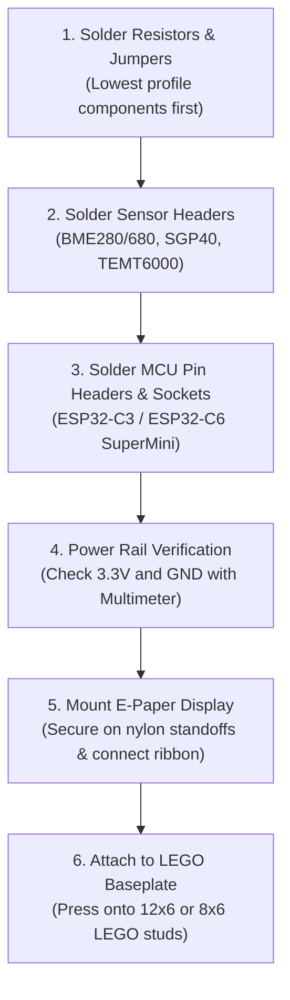

# Assembly & Soldering Guide

Building a LEGO-mounted IoT sensor board requires basic through-hole soldering skills and attention to component orientations. This step-by-step guide walks through populating both the **12×6** and **8×6 Mini** carrier boards.

---

## Required Tools & Materials

* **Soldering Station**: Temperature-controlled iron set to `320°C – 350°C` with a chisel or conical tip.
* **Solder Wire**: Lead-free or 60/40 rosin-core solder (`0.6 mm – 0.8 mm` diameter recommended).
* **Flush Cutters**: For trimming component leads flush against the bottom solder joints.
* **Desoldering Braid / Sucker**: In case of accidental solder bridges across fine-pitch pins.
* **Multimeter**: For checking 3.3V / 5V power rails and shorts before inserting the MCU.
* **M2.5 Standoffs**: 9 mm or 11 mm nylon spacers for elevating the e-paper panel above the PCB.

---

## Step-by-Step Build Sequence

### 1. Resistors & Solder Jumpers
* Begin with the lowest-profile components: surface-mount or through-hole pull-up resistors (`R1`, `R2` `4.7 kΩ`).
* If using the 8×6 Mini board, bridge solder jumpers (`JP1`–`JP6`) according to your desired bus layout.
* If using a 3.3V-only BME280 module on the 12×6 board, bridge the **3.3V** jumper pad (avoid bridging 5V).

### 2. Sensor Headers & Modules
* Solder standard 2.54 mm female pin sockets or male pin headers for the **BME280 / BME680**, **SGP30 / SGP40**, and **TEMT6000**.
* Socketing sensor modules is strongly advised over direct soldering: it allows individual sensor replacement or recalibration without desoldering the entire board.

### 3. Microcontroller Installation
* Solder two rows of female header strips for the **ESP32-C3 SuperMini** or **ESP32-C6 SuperMini**.
* Ensure the USB-C port points toward the board edge for easy cable insertion.

### 4. Power Rail Check (Do not skip!)
Before plugging in the microcontroller or display:
1. Apply 5V power via the USB-C port of the carrier board or header.
2. Using your multimeter in DC voltage mode, measure between `3.3V` and `GND` pins on the MCU socket.
3. Confirm stable 3.3V (`3.28V – 3.32V`).
4. Disconnect power before inserting the microcontroller into its socket.

### 5. Display Standoffs & Ribbon Connection
* Thread two **9 mm M2.5 nylon standoffs** into the PCB mounting holes.
* Connect the 8-pin JST ribbon cable from the WeAct E-Paper display to the corresponding PCB display header.
* Secure the display module flat onto the standoffs using M2.5 nylon screws or a small strip of 3M VHB double-sided tape.

### 6. LEGO Baseplate Mounting
* Align the four corner 4.875 mm holes of the carrier board with the studs of your baseplate (12×6 or 8×6).
* Press firmly down. The board will seat cleanly over the studs.
* Add decorative LEGO border bricks, an angled stand, or wall mounting plates to complete the installation!

