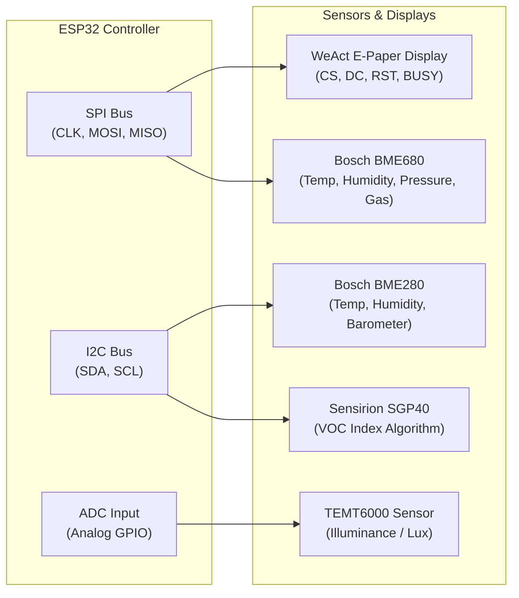

# Custom IoT Hardware Carriers

The core physical foundation of this IoT ecosystem is a pair of custom open-hardware PCB carrier boards designed in KiCad. These boards break out microcontrollers, precision environmental sensors, and low-power e-paper displays into compact modules that mount directly onto standard LEGO plates and enclosures.

---

## Carrier Board Family

-   { loading=lazy }

    **:material-expansion-card: [Sensor Carrier 12×6 (Rev 1, 2, 3)](sensor-12x6.md)**

    ---

    * **Footprint**: 12×6 LEGO plate (`96 mm × 48 mm`)
    * **Microcontroller**: ESP32-C3 SuperMini (Rev 3) / ESP32-C3-FH4 WeAct (Rev 1 & 2)
    * **Display Options**: WeAct 2.13" E-Paper (`122 × 250`) or 1.54" E-Paper (`200 × 200`)
    * **Sensors**: BME280 / BME680, SGP30 / SGP40, TEMT6000 light sensor
    * **Socketing**: Through-hole sockets for modular replacement of MCU and sensors

    [:octicons-arrow-right-24: Read 12×6 Carrier specifications](sensor-12x6.md)

-   { loading=lazy }

    **:material-chip: [Mini Sensor Carrier 8×6](sensor-1.54.md)**

    ---

    * **Footprint**: 8×6 LEGO plate (`64 mm × 48 mm`)
    * **Microcontroller**: ESP32-C6 SuperMini (WiFi 6, BLE 5, Zigbee/Thread capability)
    * **Display**: Dedicated WeAct 1.54" E-Paper (`200 × 200`, SSD1680/SSD1681)
    * **Sensors**: BME680 via SPI bus (T/P/H/VOC), TEMT6000 ambient light sensor
    * **Optimization**: Ultra-compact surface-mount jumpers with direct LCSC manufacturing BOM

    [:octicons-arrow-right-24: Read 8×6 Mini Carrier specifications](sensor-1.54.md)

---

## Hardware Comparison Matrix

| Feature | 12×6 Sensor Carrier (Rev 3) | 8×6 Mini Sensor Carrier |
|---|---|---|
| **Target Repository** | [`m-lego/sensor`](https://gitlab.com/m-lego/sensor) | [`m-lego/sensor-1.54`](https://gitlab.com/m-lego/sensor-1.54) |
| **Grid Dimensions** | 12 studs × 6 studs (`96 × 48 mm`) | 8 studs × 6 studs (`64 × 48 mm`) |
| **Mounting Holes** | 4 corner holes + 2 center (4.8 mm dia) | 4 corner holes (4.8 mm dia) |
| **Microcontroller** | ESP32-C3 SuperMini | ESP32-C6 SuperMini |
| **Wireless Protocols** | 2.4 GHz Wi-Fi 4 (802.11b/g/n), BLE 5 | Wi-Fi 6 (802.11ax), BLE 5.3, Zigbee, Thread |
| **Supported Displays** | 2.13" B&W/BWR or 1.54" B&W WeAct | 1.54" B&W/BWR WeAct E-Paper |
| **Climate Sensor** | BME280 (I2C) or BME680 (SPI) | BME680 (SPI bus) |
| **Air Quality (VOC)** | SGP30 or SGP40 (I2C) | BME680 integrated gas resistance |
| **Light Sensor** | TEMT6000 (Analog ADC) | TEMT6000 (Analog ADC) |
| **Bussing** | Dedicated SPI bus + I2C bus | Unified high-speed SPI bus |
| **Power Supply** | 5V USB-C or 3.3V header rail | 5V USB-C or 3.3V header rail |

---

## Supported Sensor Suite

### 1. Environmental Sensing
* **Bosch BME280**: Combined digital temperature, relative humidity, and barometric pressure sensor communicating over I2C (`0x76` or `0x77`). Extremely stable baselines and low current draw.
* **Bosch BME680**: Upgraded 4-in-1 sensor with volatile organic compound (VOC) gas sensing and metal oxide resistance measurements, connected over high-speed hardware SPI.
* **Sensirion SGP30 / SGP40**: Dedicated metal-oxide gas sensor calculating indoor VOC index (1–500 scale) with on-chip humidity compensation fed directly from the BME280 state.

### 2. Ambient Light & Power Gating
* **TEMT6000**: High-sensitivity phototransistor tuned to human eye sensitivity (~570 nm peak). Output voltage directly correlates with room illuminance.
* Used across the ESPHome fleet to **conditionally inhibit E-Paper display refreshes** whenever the ambient light level drops below `1.0 lx` (e.g. night in bedrooms), avoiding unwanted ghosting clears or clicking relays.

---

## Why Modular LEGO Enclosures?

1. **Precision & Consistency** — Injection-molded LEGO bricks provide tolerances under 0.01 mm, eliminating warping, layering defects, and brittle clips typical of budget FDM 3D printing.
2. **Infinite Reconfiguration** — Convert a tabletop desk clock into a wall-hanging display or angled dashboard bracket in seconds without re-designing CAD models.
3. **Thermal Management** — Generous clearance and open grid construction prevent heat from the ESP32 power converter from skewing adjacent temperature readings.
4. **Learn more** in the [LEGO Mounting & CAD Guide](lego-mounting.md).
