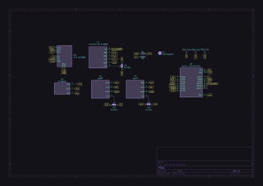
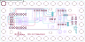
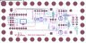
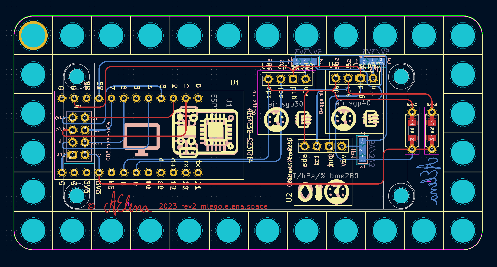
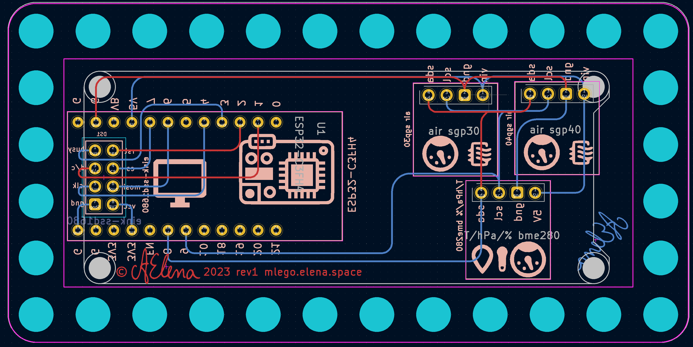
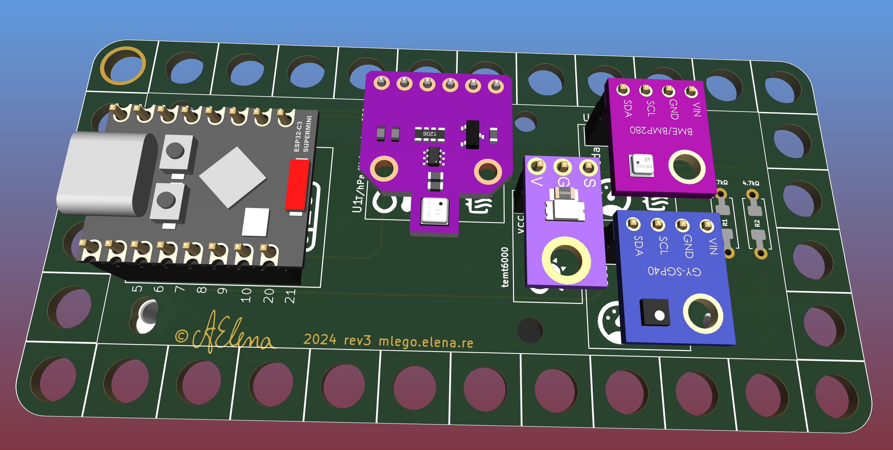
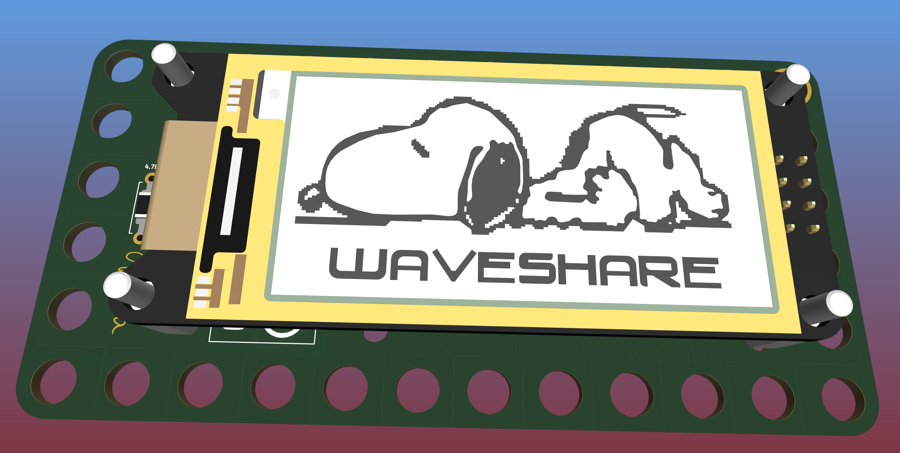
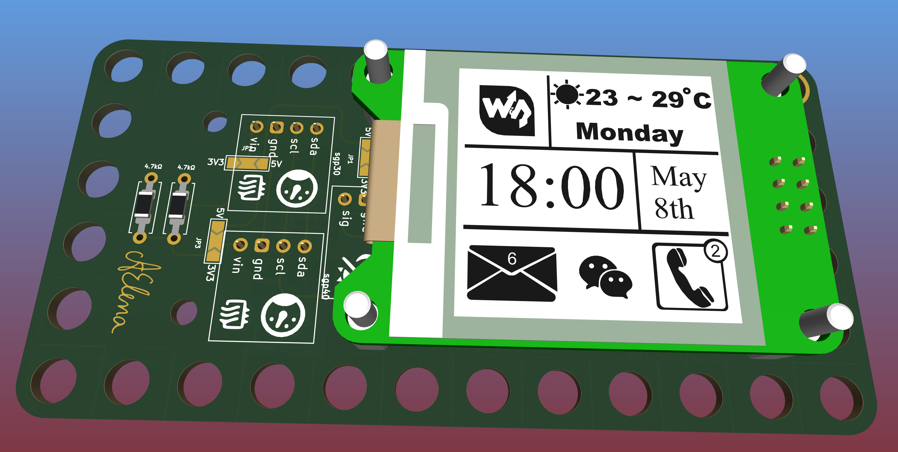
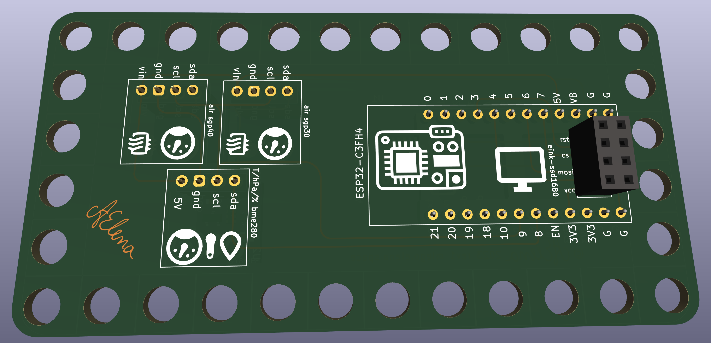

# 12×6 LEGO Indoor Sensor Board (Rev 1, 2, 3)

The **12×6 Sensor Carrier** (`m-lego/sensor`) is a full-featured modular environmental sensing platform designed to mount directly onto a standard 12×6 LEGO baseplate. It combines an ESP32 microcontroller with interchangeable e-paper displays, climate sensors, VOC air quality monitoring, and ambient light sensing.

---

## Evolution & Revision History

* **Revision 1**: Initial prototype utilizing the WeAct ESP32-C3-FH4 core module with a wide 24-way DIL socket and BME280 I2C sensor.
* **Revision 2**: Added the TEMT6000 ambient light phototransistor circuit and support for SGP30/SGP40 air quality breakout headers.
* **Revision 3 (Current Production)**:
    * Standardized on the compact **ESP32-C3 SuperMini** footprint.
    * Added dedicated hardware SPI header routing for **BME680** (allowing gas/VOC measurement alongside SPI displays).
    * Dual display mounting footprints: supports both **2.13" e-ink** (`122 × 250`) and **1.54" e-ink** (`200 × 200`) WeAct displays.
    * Integrated solder jumpers for voltage rail selection (3.3V vs 5V) and SPI chip select routing.

---

## Schematic (Revision 3)

[{ loading=lazy }](../pics/schematic-rev3.svg)
*Click image to zoom full schematic in lightbox.*

The schematic breaks out:
1. **Microcontroller Bus**: ESP32-C3 SuperMini 3.3V power, GND, hardware SPI (SCK `GPIO4`, MOSI `GPIO6`, MISO `GPIO5`), and hardware I2C (SDA `GPIO8`, SCL `GPIO9`).
2. **Display Interface**: 8-pin connector for WeAct E-Paper modules (`BUSY: GPIO3`, `RST: GPIO2`, `DC: GPIO1`, `CS: GPIO7`, `SCK: GPIO4`, `MOSI: GPIO6`).
3. **Sensor Headers**:
    * BME280 / BME680 dual footprint.
    * SGP30 / SGP40 header with pull-up resistors.
    * TEMT6000 analog light sensor fed into ADC channel (`GPIO0`).

---

## PCB Layout & Silkscreen

=== "Both Layers (Revision 3)"
    { loading=lazy width=750 }

=== "Front Silkscreen"
    [{ loading=lazy width=750 }](../pics/pcb-rev3-front.svg)

=== "Back Silkscreen"
    [{ loading=lazy width=750 }](../pics/pcb-rev3-back.svg)

=== "Bare Board Renders"
    

    -   { loading=lazy }
        **Front Copper & Soldermask**
    -   { loading=lazy }
        **Back Copper & Soldermask**
    

---

## 3D Renders with Mounted Displays

=== "2.13\" E-Paper Display"
    

    -   [{ loading=lazy }](../pics/3d-front-2-13.png)
        **Front View: 2.13" E-Paper & Sensors**
    -   [{ loading=lazy }](../pics/3d-back-2-13.png)
        **Back View: ESP32-C3 SuperMini & Wiring**
    

=== "1.54\" E-Paper Display"
    

    -   [{ loading=lazy }](../pics/3d-front-1-54.png)
        **Front View: 1.54" E-Paper & Sensors**
    -   [{ loading=lazy }](../pics/3d-back-1-54.png)
        **Back View: ESP32-C3 SuperMini & Wiring**
    

=== "PCB 3D Models"
    

    -   [{ loading=lazy }](../pics/pcb-3d-front.png)
        **Front 3D Structure**
    -   [{ loading=lazy }](../pics/pcb-3d-back.png)
        **Back 3D Structure**
    

---

## Bill of Materials (BOM)

| Component | Designator / Model | Description & Sourcing |
|---|---|---|
| **Microcontroller** | ESP32-C3 SuperMini (Rev 3) | 32-bit RISC-V @ 160MHz, 2.4GHz Wi-Fi, BLE 5, USB-C. Pinout compatible with LCSC `C5364646`. *(Rev 1 & 2 use WeAct ESP32-C3-FH4)*. |
| **E-Paper Display** | WeAct 2.13" or 1.54" | 2.13" SSD1680 (122×250) or 1.54" SSD1681 (200×200) monochrome or 3-color panel. |
| **Climate Sensor** | Bosch BME280 / BME680 | BME280 (I2C) for Temp/Hum/Press, or BME680 (SPI Rev 3) for Temp/Hum/Press + VOC gas resistance. |
| **Air Quality** | Sensirion SGP30 / SGP40 | I2C breakout module for VOC index calculation. |
| **Light Sensor** | TEMT6000 | NPN phototransistor module with load resistor for analog illuminance. |
| **Pull-Up Resistors** | R1, R2 (`4.7 kΩ`) | I2C bus pull-ups for SDA and SCL rails. |
| **DIL Socket** | 24-way wide socket | Used on Rev 1 and 2 boards for modular chip insertion. |
| **Mounting Base** | LEGO Plate 12×6 | Standard 12×6 LEGO plate (e.g. LEGO Element ID `4875` / `3028`). |
| **Hardware** | M2.5 / M2 nylon standoffs | 9 mm or 11 mm hexagonal standoffs for display standoff clearance. |

---

## Jumper Configurations

> [!IMPORTANT]
> Verify voltage jumper settings before connecting sensors!
>
> * **BME280 Jumper**: If using a 5V-tolerant breakout board with on-board LDO, bridge the 5V jumper pad. If using a bare 3.3V module, bridge the 3.3V pad directly to avoid damaging the sensor.
> * **BME680 SPI Chip Select**: When using the BME680 over SPI, configure its dedicated `CS` pin in ESPHome without conflicting with the e-paper display `CS` pin (`GPIO7`).
