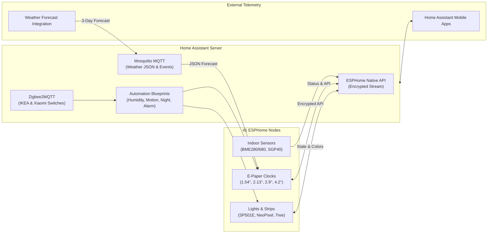

# Home Assistant Integration

[Home Assistant](https://www.home-assistant.io) serves as the central brain and command center for the entire IoT ecosystem. The repository [`48broadbent/homeassistant`](https://gitlab.com/48broadbent/homeassistant) manages the core configuration, Lovelace dashboard layouts, and integration pipelines that coordinate the hardware nodes.

---

## Centralized Architecture

---

## Integration Highlights

### 1. Instant ESPHome Auto-Discovery
Thanks to the ESPHome native API integration, newly powered-up sensor carriers (such as the 12×6 or 8×6 board) are discovered by Home Assistant within seconds over mDNS. All entities—temperature, pressure, humidity, VOC index, ambient light, Wi-Fi RSSI, and uptime—are automatically registered with appropriate icons and units of measurement.

### 2. High-Frequency Environmental Analytics
Data from across the rooms is fed into long-term statistics and climate history graphs. This enables monitoring:
* **Microclimate variations** between floors and individual rooms.
* **Ventilation adequacy** via Sensirion SGP40 VOC trends.
* **Heating efficiency** by correlating boiler firing with room temperature curves.

### 3. Coordinated Night Mode & Lighting
Home Assistant maintains a global `input_boolean.night_mode` state. Triggered by Bedtime NFC tags, bedside IKEA switches, or automated schedules, this mode:
* Suppresses audible notifications.
* Dims smart lighting strips to deep amber/warm red.
* Coordinates with e-paper clocks to enter silent standby.

