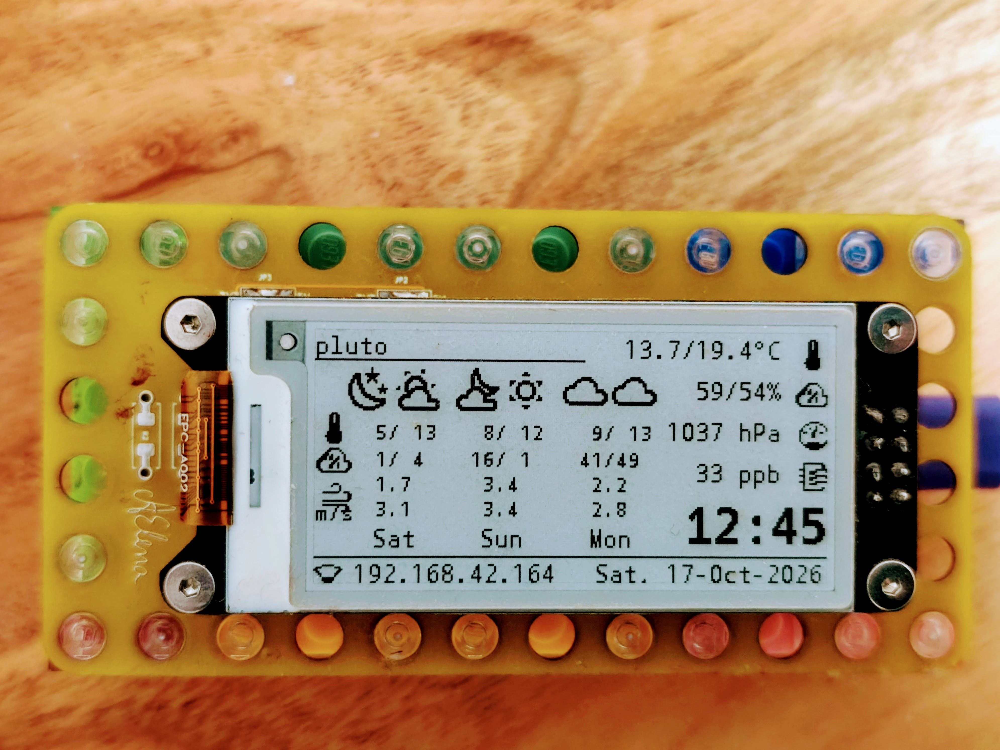
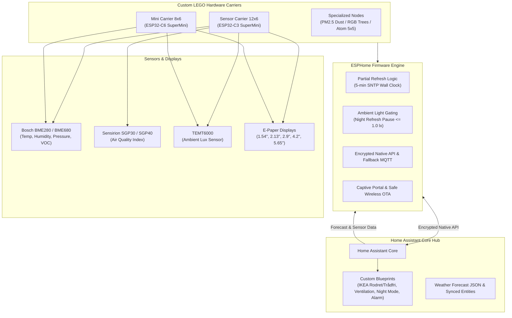
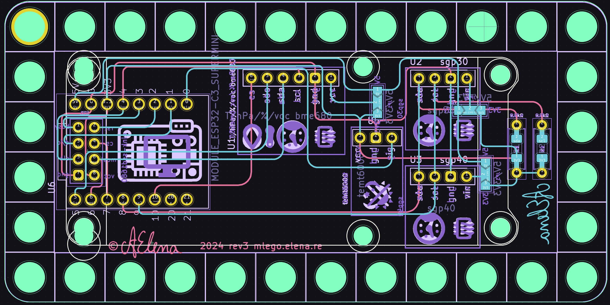
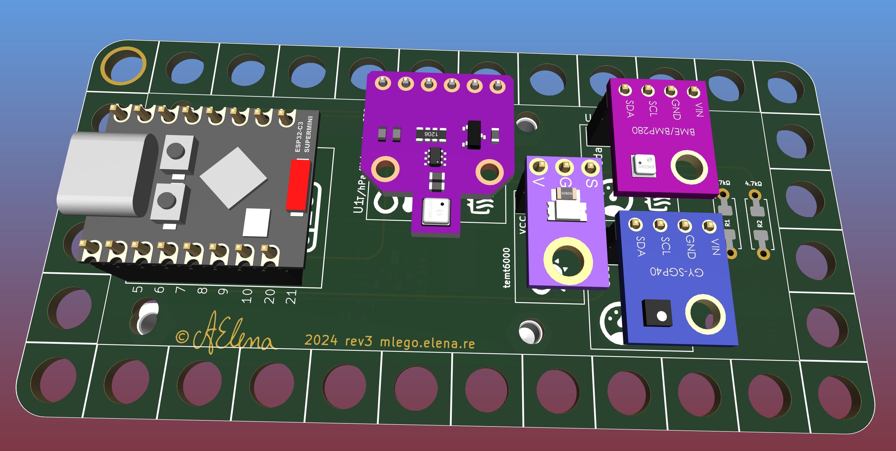
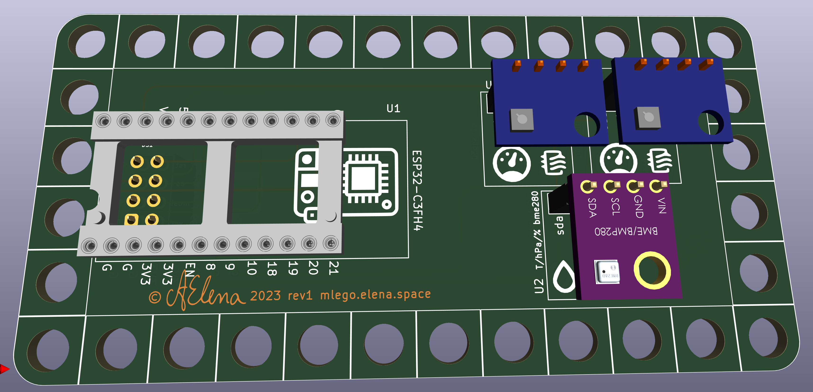
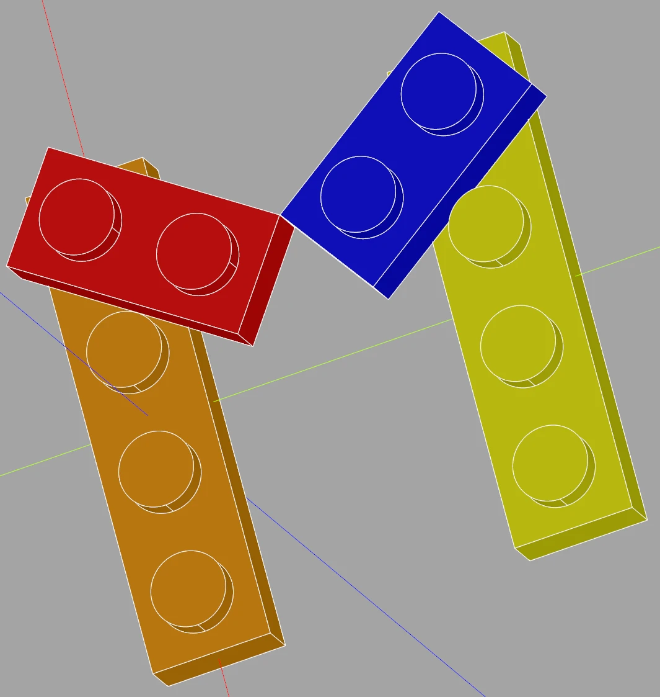

:material-chip: Open-Source IoT Hardware & Firmware

# Open IoT & Smart Home Ecosystem

Modular LEGO-mounted environmental sensor carriers, low-power E-Paper smart clocks, ESPHome fleet firmware, and coordinated Home Assistant automations.

[Explore Hardware :material-cpu-64-bit:](hardware/index.md){ .md-button .md-button--primary }
[ESPHome Node Fleet :material-access-point:](esphome/nodes.md){ .md-button }
[E-Paper Guide :material-monitor:](esphome/epaper-guide.md){ .md-button }
[Home Assistant Blueprints :material-home-automation:](homeassistant/blueprints.md){ .md-button }

{ loading=lazy }

-   :material-check-decagram:{ .lg .middle } **What This Ecosystem Is**

    ---

    * **Open Hardware Carriers** — Custom KiCad-designed carrier boards sized precisely for LEGO plates (12×6 and 8×6 grids with 4.8 mm stud-hole clearance).
    * **Low-Power Telemetry & Clocks** — Ambient-aware e-paper displays (1.54", 2.13", 2.9", 4.2", and 5.65" 7-color) updating cleanly via partial refresh and pausing during sleep.
    * **Multi-Sensor Environmental Telemetry** — Accurate indoor air quality, temperature, barometric pressure, relative humidity, VOC index, light levels, and PM2.5 dust concentrations.
    * **40+ Distributed ESPHome Nodes** — Highly dependable fleet running on ESP32-C3, ESP32-C6, ESP32-S3, ESP8266, and ESP8285 with OTA updates and encrypted API connections.
    * **Home Assistant Orchestration** — Seamless integration with Home Assistant using custom blueprints, adaptive night modes, and Zigbee/MQTT coordination.

-   :material-compass-outline:{ .lg .middle } **Design Philosophy**

    ---

    * **No Proprietary Walled Gardens** — Zero cloud lock-in. 100% local processing via ESPHome native API and local MQTT brokers.
    * **Modular & Repairable** — Modular LEGO casing allows instant prototyping, infinite color combinations, wall mounts, and desk stands without 3D printing brittle snap-fits.
    * **Power & Ghosting Awareness** — Display refresh cycles engineered to eliminate ghosting (`full_update_every: 30`) while avoiding disruptive screen flicker in living spaces.
    * **Standardized Footprints** — Interchangeable headers supporting WeAct e-paper modules, Bosch BME280/BME680, Sensirion SGP30/SGP40, and TEMT6000 light sensors.

---

## Architectural Overview

The ecosystem unites custom hardware carriers, edge firmware, and local home orchestration into a robust, self-healing loop:

---

## Key Project Pillars

-   { loading=lazy }

    **:material-cpu-64-bit: [Custom Sensor Hardware](hardware/index.md)**

    ---

    Custom KiCad carrier boards designed to fit LEGO brick dimensions:
    
    * **12×6 Carrier (rev 3)**: ESP32-C3 SuperMini, BME280/680, SGP30/40, TEMT6000, 2.13"/1.54" e-paper displays.
    * **8×6 Mini Carrier**: ESP32-C6 SuperMini, BME680 SPI, TEMT6000, and 1.54" display.
    * Includes full schematics, Gerber files, and STEP 3D models.

    [:octicons-arrow-right-24: Browse hardware designs](hardware/index.md)

-   { loading=lazy }

    **:material-monitor: [E-Paper Display Guide](esphome/epaper-guide.md)**

    ---

    Exhaustive documentation on driving SPI e-paper displays in ESPHome:
    
    * Tested controllers: SSD1680, SSD1681, SSD1683, GooDisplay GDEY042T81, Inkplate 6 Color.
    * Fast monochrome partial refresh (< 0.3s) without screen flashing.
    * Nighttime refresh pause based on ambient light level (`TEMT6000 <= 1.0 lx`).

    [:octicons-arrow-right-24: Read e-paper driver notes](esphome/epaper-guide.md)

-   { loading=lazy }

    **:material-access-point: [ESPHome Node Fleet](esphome/nodes.md)**

    ---

    A deployed fleet of **41 production nodes** across indoor and outdoor spaces:
    
    * **Celestial & Malebranche naming system**: Pluto, Venus, Jupiter, Saturn, Uranus, Moon, Mars, Alichino, Calcabrina, etc.
    * Multi-room climate monitors, PM2.5 dust monitors, holiday lighting strips, and M5Stack Atom Matrix LED displays.

    [:octicons-arrow-right-24: Explore the 41-node catalog](esphome/nodes.md)

-   { loading=lazy }

    **:material-home-automation: [Home Assistant & Blueprints](homeassistant/index.md)**

    ---

    Automations tying the sensor ecosystem into daily routines:
    
    * Blueprints for bathroom humidity extraction fans.
    * Ambient-lux-gated motion lighting and dynamic night mode.
    * IKEA Rodret, Somrig, and Trådfri wireless switch event controllers.

    [:octicons-arrow-right-24: View automation blueprints](homeassistant/blueprints.md)

---

## Linked Repositories

| Repository | Platform | Description |
|---|---|---|
| [48broadbent / broadbent](https://gitlab.com/48broadbent/broadbent) | GitLab | Production ESPHome firmware configurations, e-paper display routines, and fleet deployments. |
| [48broadbent / ha-blueprints](https://gitlab.com/48broadbent/ha-blueprints) | GitLab | Curated Home Assistant blueprints (humidity extraction, lighting, remotes, alarm). |
| [48broadbent / homeassistant](https://gitlab.com/48broadbent/homeassistant) | GitLab | Central Home Assistant configuration, dashboard YAML, and automations. |
| [m-lego / sensor](https://gitlab.com/m-lego/sensor) | GitLab | KiCad schematics, PCB layout, 3D STEP models, and BOM for 12×6 LEGO multisensor carrier. |
| [m-lego / sensor-1.54](https://gitlab.com/m-lego/sensor-1.54) | GitLab | KiCad PCB design and production BOM for ultra-compact 8×6 LEGO ESP32-C6 sensor board. |
| [alinelena / mlego](https://github.com/alinelena/mlego) | GitHub | Inspiration codebase and style guide for modular LEGO mechanical keyboards & documentation. |
| [alinelena / iot](https://github.com/alinelena/iot) | GitHub | Source repository and automated build pipeline for this documentation website. |

